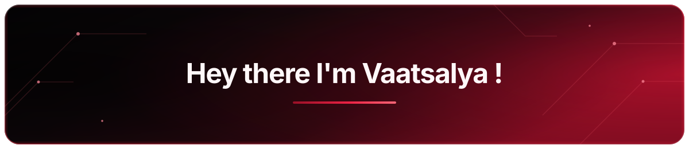

  

  
  

---

## 🧑‍💻 About Me

- 🎓 **B.Tech ECE @ DTU** — focusing on high-performance systems, robotics, and ML.
- 🔥 **Passionate about AI & ML** — building intelligent systems and scalable software.
- 🤖 **Robotics & Embedded Development** — working with autonomous systems and electronics hardware.
- 🌱 Currently exploring **Agentic AI, ML, computer vision, robotics, open-source development and quantum computing.**

---

  

